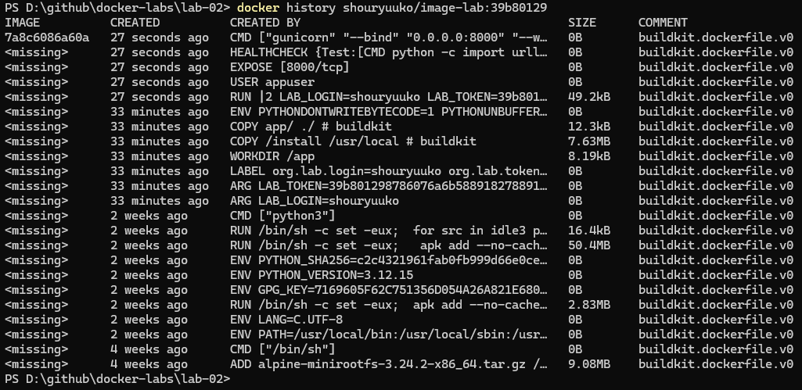
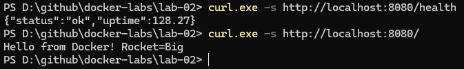
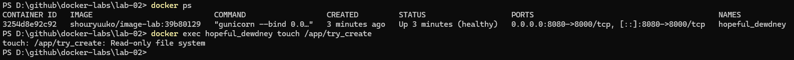
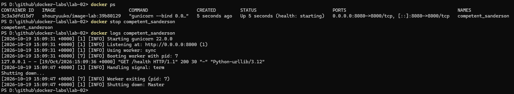

Ссылка на образ: https://hub.docker.com/r/shouryuuko/image-lab/tags

### Преимущества данного образа

---

- Многоэтапная сборка, минимизация размера образа: в образ попадают только необходимые зависимости, без временных файлов, кеша пакетного менеджера.
- Запуск от имени непривилегированного пользователя, с ограниченными правами: права выделнны только на директорию приложения.
- Поддержка режима `--read-only`, за счет ограничения кеширования и перенаправления логов приложения на прямую в консоль контейнера.
- Корректная обработка сигнала `SIGTERM`: `gunicorn` по умолчанию корректно обрабатывает принудительное завершение работы контейнера 

Исключение: передача аргументов `LOGIN` и `TOKEN` через аргументы сборки небезопасно, поскольку их можно просмотреть выполнив команду `docker history...`

### Проверка сборки

---

#### История сборки

#### Проверка эндпоинтов

#### Проверка поддержки работы с `--read-only`

#### Проверка `SIGTERM`

