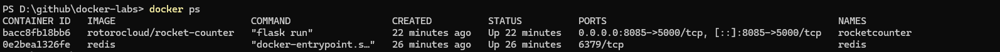
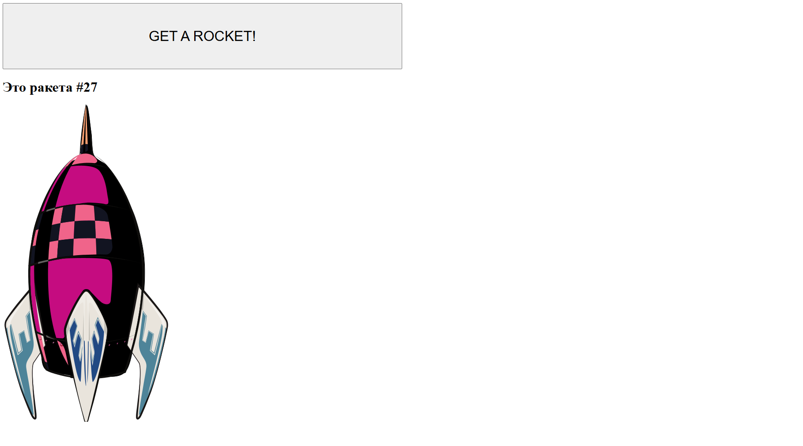
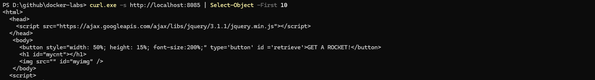
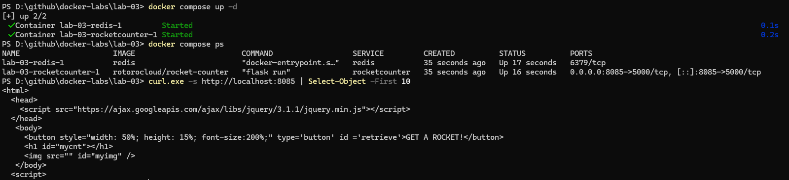
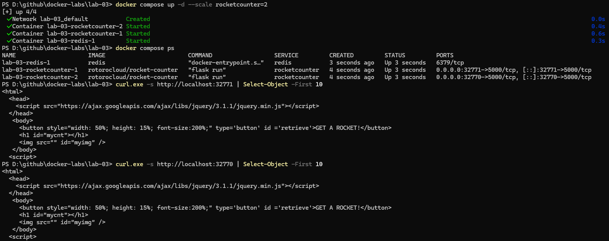
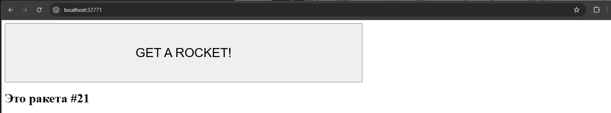
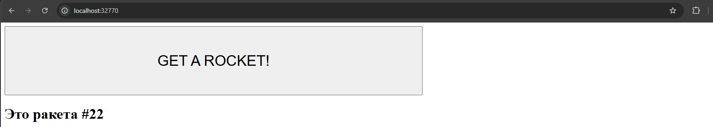
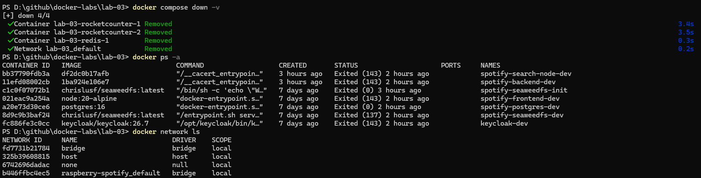

### Запуск контейнера вручную

Создание и запуск контейнера `redis`:

```sh
docker run -d --name redis redis
docker run -d --name rocketcounter \
    --link redis:redis -p 8085:5000 rotorocloud/rocket-counter
```

Проверяем, что котнейнеры запущены и работают:



Проверяем работу сайта:





### Описание стека через `docker-compose.yml`

Создаем файл `docker-compose.yml` и объявляем сервисы:

```yml
services:
    redis:
        image: redis

    rocketcounter:
        image: rotorocloud/rocket-counter
        ports:
            - "8085:5000"
```

Запускаем и тестируем стек:



### Масштабирование приложения

Корректируем `docker-compose.yml`, заменяя фиксированный порт на автоматическое определение:

```yml
ports:
    - "0:5000"
```

Запускаем и тестируем стек:



Проверяем что счетчик один:





### Очистка стека

```sh
docker compose down -v
```



### Вопросы

1. `--link` - механизм для связывания контейнеров вручную, в Compose все сервисы по умолчанию находятся в одной пользовательской сети. 
2. `image` указывает на образ из реестра, `build` требует предварительно собрать образ на основе `Dockerfile`.
3.  Порт может быть привязан только в одному контейнеру. Способы обойти:
    1. Динамическая публикация
    2. Диапазон портов
    3. Обратные прокси или балансировщик
4. с `-v` удаляются именованные тома.
5. Compose создает для проекта отдельную сеть, где каждый контейнер получает в ней свое DNS-имя совпадающее с именем сервиса в `docker-compose.yml`.
